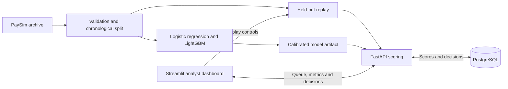

# Real-Time Payment Fraud Detection & Risk Scoring

An ML learning and portfolio project: train a model on PaySim-style payments, score a replayed stream through FastAPI, and investigate decisions in Streamlit. Data and decisions here are synthetic demonstrations.

## Architecture



## Quick start with Docker

1. Install Docker with Compose. From this directory, build the image: `docker compose build`.
2. Train the fixture model: `docker compose run --rm --no-deps api python -m training.train --data data/fixture/paysim_sample.csv --output artifacts`.
3. Start the API, database and dashboard: `docker compose up -d --wait api dashboard`.
4. Open `http://localhost:8501`. Check `http://localhost:8000/health` for model readiness.
5. Replay only held-out fixture steps: `docker compose --profile replay run --rm simulator`. Press Ctrl+C to stop a running replay.
6. Inspect a transaction, its SHAP contributions, and save an analyst disposition. Refresh to see metrics and charts.

The 30-row fixture is for a workflow check. A clean workspace can run it without downloading PaySim. If a full-data artifact is already present, the API selects it by default. Set `MODEL_PATH=/app/artifacts/model.joblib` in the Compose environment to explicitly serve the fixture artifact.

## Phase 2 data preparation

Use Edgar Lopez-Rojas’s [PaySim release on Kaggle](https://www.kaggle.com/datasets/ealaxi/paysim1/metadata). Save the single-CSV ZIP as `data/raw/paysim.zip`. The archive and generated artifacts stay out of Git. With Docker available, run this from PowerShell in the project directory:

```powershell
docker compose run --rm --no-deps -v "${PWD}:/app" api python -m training.prepare --data data/raw/paysim.zip
```

The profiler reads the archive in chunks and writes `artifacts/data_profile.json` with schema checks, missing and invalid values, fraud counts by type and step, balance and amount summaries, and split boundaries. Training uses the same validation and split logic. The downloaded release contained 6,362,620 accepted transactions, including 8,213 fraud labels (0.129%).

| Split | Steps | Transactions | Fraud rate |
| --- | --- | ---: | ---: |
| Train | 1–445 | 6,010,937 | 0.083% |
| Validation | 446–594 | 228,103 | 0.680% |
| Test | 595–743 | 123,580 | 1.338% |

These splits allocate distinct steps by time. Transaction volume and fraud prevalence vary across the three periods, so their row totals differ from a 60/20/20 row split.

## API and data flow

`POST /transactions/score` accepts `transaction_id`, PaySim `step`, `type`, `amount`, `nameOrig`, `oldbalanceOrg`, `nameDest`, `oldbalanceDest`, and optional `isFraud` for replay evaluation. The response includes calibrated `fraud_probability`, score out of 100, risk band, recommended action, model version, and five leading SHAP contributions. `GET /transactions`, `GET /transactions/{id}`, and `GET /metrics` drive the dashboard. `PATCH /transactions/{id}/disposition` accepts `{"disposition":"approve|review|decline","note":"..."}`. Duplicate IDs return 409; missing model artifacts return 503. The replay is a foreground process and can be stopped with Ctrl+C.

The API prefers `artifacts/phase3/model.joblib` when present and otherwise uses `artifacts/model.joblib`. Set `MODEL_PATH` to an alternate container path to override it and recreate the API. Use `GET /health` to check database and model readiness and confirm the active model version. Incompatible or unreadable artifacts return 503. The API and dashboard are published on localhost for the local demo.

## Modeling choices and limitations

- Split by ordered `step`: first 60% of distinct steps for training, next 20% for validation, last 20% for test. Both classes must appear in every segment.
- The model uses log-transformed amount and one-hot transaction type. The [PaySim data card](https://www.kaggle.com/datasets/ealaxi/paysim1/metadata) advises excluding all four balance columns because of fraud cancellations. Balances remain available for data exploration. Step is used for the chronological split, and account IDs remain transaction metadata. Account-history features are deferred until earlier events can be tracked consistently during training and scoring.
- Logistic regression is the baseline. LightGBM candidates are chosen on validation PR-AUC, then calibrated on validation data. Thresholds come from validation scores and are applied unchanged to test data. The generated `artifacts/metrics.json` includes PR-AUC, ROC-AUC, recall at 1% FPR, band metrics, a decline confusion matrix and estimated known fraud amount blocked.
- SHAP explains the underlying LightGBM margin, while the displayed probability comes from calibration. Contributions should not be added directly to obtain the calibrated probability.
- PaySim is synthetic and contains no demographic fields for group fairness analysis. The model card in `artifacts/model_card.md` states these limitations and monitoring signals. The demo's known-fraud and blocked-loss KPIs use replay labels; a live operation would only know those after investigation.

## Phase 3 full-data training

```powershell
docker compose run --rm --no-deps -v "${PWD}:/app" -e OPENBLAS_NUM_THREADS=2 -e OMP_NUM_THREADS=4 api python -m training.train --data data/raw/paysim.zip --output artifacts/phase3
```

Artifact outputs are `model.joblib`, `metrics.json`, and `model_card.md` under `artifacts/phase3`. The early validation period selects the LightGBM candidate and fits sigmoid calibration. The later validation period determines the action thresholds. Review uses the 95th percentile score, with ties included. Decline requires at least 80% observed precision over at least 20 scored transactions above the review threshold. When no cutoff qualifies, the decline band is disabled. The test period evaluates the locked policy and compares the model with the logistic regression baseline.

## Verification and demo evidence

### Phase 5 analyst replay

Export the ordered holdout once after generating the Phase 2 profile:

```powershell
docker compose run --rm --no-deps -v "${PWD}:/app" api python -m simulator.replay --data data/raw/paysim.zip --profile artifacts/data_profile.json --export artifacts/phase3/test_events.csv
```

Open the dashboard, choose a start step, speed, and transaction limit, then select **Start replay**. Select **Stop replay** to prevent further requests after the current one finishes. Runs get fresh transaction IDs so the same range can be demonstrated again. If the held-out export is missing, the dashboard replays the six fixture events instead. Live refresh updates the console every three seconds. Trends show the latest 1,000 records matching the filters, while the KPI cards cover all saved transactions. Known-fraud rates use labeled payments only.

### One-minute demo

1. Start the Compose stack and open the dashboard at `http://localhost:8501`. Open `http://localhost:8000/health` in a second tab to show the active model version.
2. Start a short replay. Point out the processed count and alert queue as scores arrive. On the fixture, replaying steps 9–10 produces six transactions, including two review cases.
3. Filter the queue to **review** and select a payment. Show its score, recommended action, and the top SHAP features. Explain that SHAP describes the model output before calibration.
4. Set the analyst disposition to **approve**, add a note, and save. Reopen that transaction to show the saved decision alongside the original review recommendation.
5. Show the held-out model results separately from the dashboard. LightGBM reached 0.341 average precision against 0.114 for logistic regression and 33.6% recall at a 1% false-positive rate against 15.3% for logistic regression. The full report is `artifacts/phase3/metrics.json`.

Run `docker compose run --rm --no-deps api pytest -q` to verify the code in the built image. Rebuild first after changing source or tests.

The Phase 6 verification used an isolated Compose project with an empty PostgreSQL database. Fixture training and scoring ran without the full PaySim archive. All six held-out requests returned HTTP 201 and saved five SHAP contributions each. After restarting the stack, all six records were still present. An analyst approval on a review case also persisted after an API restart, alongside the original recommendation.

## Public portfolio demo on Render

The [Blueprint](render.yaml) provisions a public read-only Streamlit dashboard, a private scoring API, and a private PostgreSQL database. The API loads the bundled LightGBM model and seeds 48 curated synthetic examples once. Visitors can filter and inspect scores and explanations. Local Docker Compose supports replay controls and analyst decisions.

Push this repository to GitHub, then open [Render Blueprints](https://dashboard.render.com/blueprints), connect that repository, and select `main`. Review the paid service and database estimates before applying the Blueprint. After the deploy completes, open the dashboard URL printed by Render. The full PaySim download is only needed for local training. See the [demo artifact provenance](deploy/demo/README.md).
